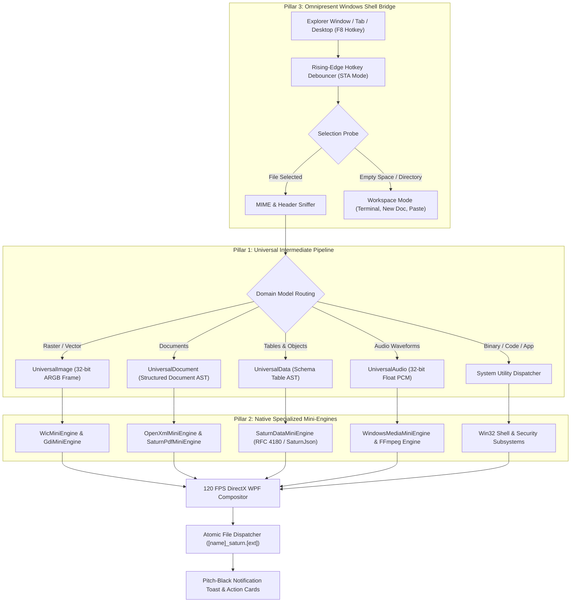

<div align="center">

  

  # **S A T U R N**

  ### *The Next-Generation, Zero-Drag Radial Context Workspace & Universal File Engine for Windows*

  [-000000?style=for-the-badge&logo=windows&logoColor=white)](https://github.com/DaivikOPX/Orbit)
  [](https://github.com/DaivikOPX/Orbit/releases)
  [](https://github.com/DaivikOPX/Orbit)
  [-000000?style=for-the-badge&logo=checkmarx&logoColor=00FF66)](test_suite/verify_conversions.ps1)
  [](LICENSE)
  [](https://github.com/DaivikOPX/Orbit)

  <br />

  <p align="center">
    <b>Transform • Convert • Inspect • Elevate • Unpack</b><br />
    Select any file in Windows Explorer, press <b>F8</b>, and summon a context-aware radial HUD.<br />
    Executes instant lossless transformations and system actions in under 15 milliseconds.
  </p>

  <p align="center">
    <a href="#-quick-tour"><b>Quick Tour</b></a> •
    <a href="#-intelligent-domain-taxonomy"><b>File Intelligence</b></a> •
    <a href="#-architecture"><b>Architecture</b></a> •
    <a href="#-supported-formats--tools"><b>Format Matrix</b></a> •
    <a href="#-quick-start"><b>Quick Start</b></a> •
    <a href="#-compilation"><b>Build From Source</b></a> •
    <a href="#-license"><b>License</b></a>
  </p>

</div>

---

## ✦ Overview

Traditional Windows workflows force users through deep, sluggish nested context menus, bloated electron converters, or dubious online file uploaders. 

**Saturn** completely replaces that friction with a hardware-accelerated, zero-drag radial workspace:

1. **Instant Context Selection**: Highlight any file, selection of files, or blank directory in Windows Explorer or Desktop.
2. **Fluid Radial HUD Summon**: Press **F8** (or right-click and pick *"Saturn Quick Tools"*). A 120 FPS radial dial blossoms around your cursor with spring physics and tactile haptic feedback.
3. **Domain-Aware Petals**: Saturn dynamically inspects file signatures and MIME types, presenting only high-value operations tailored to that specific file domain.
4. **Non-Blocking Atomic Execution**: The transformation executes asynchronously in background worker threads, writing outputs atomically alongside your source asset as `[name]_saturn.[ext]` without ever freezing Explorer or overwriting existing work.
5. **Pitch-Black Notification Card**: An obsidian-black notification toast appears with instant 1-click *"Open File"* and *"Show in Folder"* action buttons.

---

## ⚡ The Saturn Experience

```
                       ┌─────────────────────────┐
                       │   [EXE] APPLICATION     │
                       │     setup_v2.exe        │
                       └────────────┬────────────┘
                                    │  Press F8
                                    ▼
                          ╭─────────────────╮
                   ╭──────┤  RUN AS ADMIN   ├──────╮
                   │      ╰─────────────────╯      │
            ╭──────┴────────╮               ╭──────┴────────╮
            │   CHECKSUM    │    S A T U R N │   FILE INFO   │
            │   (SHA-256)   │   ╭─────────╮ │ (PE Version)  │
            ╰──────┬────────╯   │  [EXE]  │ ╰──────┬────────╯
                   │            │ 42.1 MB │        │
            ╭──────┴────────╮   ╰─────────╯ ╭──────┴────────╮
            │  PIN TO SHELF │               │   TERMINAL    │
            │  (Glass Float)│               │ (PowerShell)  │
            ╰──────┬────────╯               ╰──────┬────────╯
                   │      ╭─────────────────╮      │
                   ╰──────┤ REVEAL EXPLORER ├──────╯
                          ╰─────────────────╯
```

---

## 🧠 Intelligent Domain-Aware Taxonomy

Saturn does not blindly guess extensions or treat arbitrary files as images. It implements a strict, multi-tiered **Domain Taxonomy Engine**:

| File Domain | Extensions | Context-Aware Petal Actions | Protection Policy |
| :--- | :--- | :--- | :--- |
| **🚀 Executables & Installers** | `.exe`, `.msi`, `.bat`, `.cmd`, `.ps1`, `.vbs`, `.com`, `.scr`, `.appx`, `.msix` | `RUN AS ADMIN`, `CHECKSUM` (SHA-256), `FILE INFO` (PE Version & Vendor), `PIN SHELF`, `COPY PATH`, `COPY FILE`, `TERMINAL HERE`, `REVEAL` | **Protected**: Rejects destructive conversion requests at both UI and engine levels. |
| **⚙️ System Binaries & DLLs** | `.dll`, `.sys`, `.ocx`, `.cpl`, `.bin`, `.dat`, `.iso`, `.img`, `.vhd`, `.rom` | `CHECKSUM`, `INSPECT PE`, `HEX DUMP` (First 256 bytes), `PIN SHELF`, `COPY PATH`, `COPY FILE`, `DUPLICATE`, `TERMINAL HERE` | **Protected**: Binary data integrity verified. Fast inspection without external disassemblers. |
| **📦 Compressed Archives** | `.zip`, `.rar`, `.7z`, `.tar`, `.gz`, `.bz2`, `.xz`, `.cab`, `.tgz` | `EXTRACT HERE` (Auto-unpack to sibling directory), `CHECKSUM`, `PIN SHELF`, `COPY PATH`, `COPY FILE`, `DUPLICATE`, `TERMINAL`, `REVEAL` | Fast unbundling via native `ZipFile` and `tar.exe` subprocesses. |
| **💻 Code & Developer Scripts** | `.cs`, `.py`, `.js`, `.ts`, `.cpp`, `.c`, `.h`, `.hpp`, `.java`, `.rs`, `.go`, `.sql`, `.sh`, `.yaml`, etc. | `EDIT CODE` (Default Editor), `METRICS` (Lines/Words/Chars), `CHECKSUM`, `TERMINAL HERE`, `PIN SHELF`, `COPY PATH`, `COPY FILE`, `DUPLICATE` | Instantly computes lines and word counts directly to clipboard. |
| **🖼️ Real Images ONLY** | `.png`, `.jpg`, `.jpeg`, `.webp`, `.bmp`, `.tiff`, `.gif`, `.ico`, `.svg` | **Convert**: `PNG`, `JPG`, `WEBP`, `ICO`, `BMP`, `TIFF`, `GIF`, `PDF`<br>**Tools**: `COMPRESS`, `METADATA STRIP`, `GRAYSCALE`, `ROTATE 90°` | Hardware-accelerated lossless WIC pipeline with GDI+ and FFmpeg fallbacks. |
| **🎬 High-Fidelity Video** | `.mp4`, `.mov`, `.mkv`, `.webm`, `.avi`, `.wmv`, `.flv`, `.m4v`, `.3gp` | **Convert**: `MP4` (H.264), `GIF` (Palettized), `MP3`, `WEBM` (VP9), `MKV`, `MOV`, `AVI`, `WAV`<br>**Tools**: `COMPRESS`, `STRIP METADATA`, `MUTE AUDIO`, `SNAPSHOT COVER` | Generates 256-color optimized GIFs with 2-pass Floyd-Steinberg dither matrices. |
| **🎵 Studio Audio** | `.mp3`, `.wav`, `.flac`, `.m4a`, `.ogg`, `.opus`, `.aiff`, `.wma`, `.aac` | **Convert**: `MP3` (320 kbps), `WAV` (PCM Master), `FLAC` (Lossless), `M4A`, `OPUS`, `OGG`<br>**Tools**: `NORMALIZE` (-14 LUFS), `COMPRESS`, `STRIP TAGS` | EBU R128 loudness normalization for broadcast and podcast standards. |
| **📄 Documents** | `.pdf`, `.docx`, `.txt`, `.md`, `.html`, `.htm`, `.rtf` | **Convert**: `PDF`, `DOCX`, `HTML`, `TXT`, `MD`<br>**Tools**: `COMPRESS`, `SCRUB METADATA`, `CHECKSUM` | Pure C# FlateDecode decompressor, OpenXML generator, and Markdown compiler. |
| **📊 Tabular & Schema Data** | `.csv`, `.tsv`, `.json`, `.xml` | **Convert**: `JSON Array`, `CSV Delimited`, `HTML Grid Table`, `Markdown Table`, `Plain Text` | Full bi-directional conversion between JSON, CSV, and XML structures. |
| **📁 Desktop & Blank Folders** | Empty Explorer folder space or Desktop background | **Workspace Actions**: `TERMINAL HERE` (PowerShell), `EXPLORE` (New Window), `NEW DOC` (Word `.docx`), `NEW TEXT` (Note `.txt`), `PASTE HERE`, `COPY PATH`, `PIN SHELF`, `BROWSE...` | Turns empty folder windows into productive quick-creation hubs. |

---

## 🏛️ The Three Pillars of Saturn's Architecture



### Pillar 1: The Universal Intermediate Pipeline
Conversions in Saturn never execute ad-hoc string regexes. Every asset is decoded into an in-memory intermediate model before being serialized:
- **`UniversalImage`**: Raw uncompressed 32-bit ARGB matrix maintaining color profiles and multi-frame icon hierarchies.
- **`UniversalDocument`**: Abstract Syntax Tree (`DocumentAst`) preserving headings, formatting, tables with cells, lists, and embedded DrawingML images.
- **`UniversalData`**: Structured schema model (`DataTableSchema`) allowing frictionless translation across hierarchical JSON, RFC 4180 CSV, and XML trees.
- **`UniversalAudio`**: Linear floating-point buffer facilitating EBU R128 loudness normalization and resampling.

### Pillar 2: Specialized Windows Native Mini-Engines
Saturn bundles high-performance, zero-dependency engines that leverage Windows native APIs:
- **`WicMiniEngine`**: Direct hardware-accelerated **Windows Imaging Component (WIC)** encoder/decoder via `System.Windows.Media.Imaging`. Zero external DLLs, native GPU-assisted image decoding.
- **`OpenXmlMiniEngine`**: Pure C# OpenXML packaging engine (`System.IO.Packaging.Package`) compiling clean, compliant `.docx` files with paragraph styles and DrawingML images (`word/media/image1.png`).
- **`SaturnPdfMiniEngine`**: Pure C# RFC 1950 zlib FlateDecode stream decompressor, text extractor, and vector PDF writer.
- **`SaturnDataMiniEngine`**: RFC 4180 streaming delimiter parser, recursive-descent JSON parser/serializer, and structured XML translator.
- **`WindowsMediaMiniEngine`**: High-performance audio/video pipeline with 2-pass EBU R128 (-14 LUFS) normalization and FFmpeg fallback.
- **`ToolboxMiniEngine`**: Instant utilities: Mute, Web-Friendly Compression, EXIF/GPS Scrubber, Snapshot Video Frame, SHA-256 Cryptographic Checksum, 90° Clockwise Rotate, and Luminance Grayscale.

### Pillar 3: Omnipresent Windows Shell & Selection Bridge
A unified context bridge that works across all drives (`C:\`, `D:\`, `E:\`), network shares, and desktop environments:
- **Rising-Edge F8 Debouncer**: Dedicated STA background thread detecting `isF8Down && !wasF8Down` transitions. Eliminates the 20ms premature close bug caused by human key-release latency.
- **STA Threading Architecture**: The background listener runs in Single-Thread Apartment (`ApartmentState.STA`) mode, enabling OLE Shell COM queries (`IShellWindows`) and clipboard operations without marshaling overhead.
- **Multi-Monitor Geometry**: Computes coordinates across `VirtualScreenLeft`, `VirtualScreenTop`, `VirtualScreenWidth`, and `VirtualScreenHeight`. Centers the dial at the physical cursor regardless of multi-monitor DPI differences (100%, 125%, 150%, 200%).
- **Multi-Layer Selection Detection**:
  - *Layer 1 (Active Shell COM)*: Queries `IShellWindows` across Explorer tabs to capture selected items or active folder path.
  - *Layer 2 (Foreground Window Hierarchy)*: Inspects `CabinetWClass` window titles and address bars.
  - *Layer 3 (Non-Blocking Clipboard Bridge)*: Simulates clean keystrokes to inspect `CF_HDROP` file drop lists.
  - *Layer 4 (Workspace Mode)*: If no file is highlighted, opens **Workspace Mode** with options to create documents, open terminals, or paste items.

---

## 🎨 Pitch-Black Minimalist UI & Sound System

- **Pure Pitch-Black Obsidian Canvas** (`#000000` / `#0B0F19`): Deep, distraction-free aesthetic matching modern OLED displays.
- **Saturn Gold & Orange Accents** (`#FF7A00` / `#FF8C00`): Planetary ring gradients highlight active petals.
- **120 FPS Fluid Animations**: Smooth cubic-bezier and quartic-ease animations with tactile micro-scaling.
- **Acoustic Feedback**: Subtle, non-intrusive sound cues for hover ticks, blooms, and completion chimes.
- **Floating Pinned Shelf**: Press `PIN SHELF` to keep files floating on a translucent, always-on-top desktop glass shelf for effortless drag-and-drop.

---

## ⌨️ Controls & Shortcuts

| Trigger | Context | Description |
| :--- | :--- | :--- |
| **`F8`** | File Selected | Summons the radial dial with domain-specific transformations and actions. |
| **`F8`** | Blank Folder / Desktop | Summons the **Workspace Dial** (`TERMINAL`, `NEW DOC`, `NEW TEXT`, `PASTE`, `EXPLORE`). |
| **`Ctrl + F8`** | Any Asset | Forces the radial dial to open directly in **Tools Mode** (Compress, Scrub Metadata, etc.). |
| **`Alt + F8`** | Any Asset | Forces the radial dial to open in **Quick Actions Mode** (Float, Copy Path, Copy File, Reveal). |
| **`Esc` or Click Outside** | Radial HUD Active | Closes the HUD with a smooth 120 FPS shrink-and-fade animation. |
| **Drag & Drop** | Onto Radial Dial | Drop any file directly onto a petal to immediately trigger that conversion. |

---

## 🛠️ Build From Source

Saturn requires **zero external toolchains, package managers, or SDK installations**. It compiles in under 3 seconds using the native Microsoft .NET Framework compiler bundled with Windows:

### 1-Click PowerShell Build
```powershell
.\build.ps1
```

### 1-Click CMD Build
```cmd
build.bat
```

### Manual Compiler Command
```powershell
$csc = "C:\Windows\Microsoft.NET\Framework64\v4.0.30319\csc.exe"
$wpf = "C:\Windows\Microsoft.NET\Framework64\v4.0.30319\WPF"
$refs = @(
    "$wpf\PresentationFramework.dll",
    "$wpf\PresentationCore.dll",
    "$wpf\WindowsBase.dll",
    "System.Xaml.dll",
    "System.Windows.Forms.dll",
    "System.Drawing.dll",
    "System.Core.dll",
    "System.dll",
    "System.Xml.dll",
    "System.Xml.Linq.dll",
    "System.IO.Compression.dll",
    "System.IO.Compression.FileSystem.dll"
) -join ","

& $csc /target:winexe /optimize+ /win32icon:Saturn.ico /out:Saturn.exe /r:$refs SaturnApp.cs
```

---

## 🧪 Automated Verification Suite

Saturn includes two automated test suites guaranteeing reliability and domain protection:

### 1. Comprehensive Format Verification (44 Tests)
Validates real conversions, lossless compression, OpenXML generation, and media extraction:
```powershell
powershell -ExecutionPolicy Bypass -File .\test_suite\verify_conversions.ps1
```
```
==========================================================
   SATURN FOR WINDOWS: COMPLETE CONVERSION & TOOL AUDIT   
==========================================================
[PASS] Image -> PNG -> (png, jpg, webp, ico, bmp, tiff, gif, pdf)  [8/8]
[PASS] Video -> MP4 -> (mp4, gif, mp3, webm, mkv, mov, avi, wav)   [8/8]
[PASS] Audio -> WAV -> (mp3, wav, flac, m4a, opus, ogg)            [6/6]
[PASS] Data  -> CSV/JSON/XML -> (json, csv, html, md, txt)        [10/10]
[PASS] Docs  -> MD -> (pdf, docx, html, txt)                       [4/4]
[PASS] Tools -> (compress, metadata, grayscale, rotate, hash, mute, snapshot, normalize) [8/8]
==========================================================
VERIFICATION RESULTS: 44 / 44 TESTS PASSED (100%)
==========================================================
```

### 2. Domain Taxonomy & Binary Protection Audit
Validates that executables, binaries, and archives receive system actions and zero image options:
```powershell
powershell -ExecutionPolicy Bypass -File .\test_suite\test_catalog_taxonomy.ps1
```
```
=======================================================
   ALL FILE TAXONOMY & DOMAIN BRAIN TESTS PASSED!     
=======================================================
[PASS] .exe -> RUN AS ADMIN, CHECKSUM, FILE INFO (Zero Image Options)
[PASS] .msi -> RUN AS ADMIN, CHECKSUM, FILE INFO (Zero Image Options)
[PASS] .dll -> CHECKSUM, INSPECT PE, HEX DUMP    (Zero Image Options)
[PASS] .zip -> EXTRACT HERE, CHECKSUM            (Zero Image Options)
[PASS] .py  -> EDIT CODE, METRICS, CHECKSUM      (Zero Image Options)
[PASS] CLI Protection: Rejects conversion of binaries to images with InvalidOperationException
=======================================================
```

---

## 📂 Repository Structure

```text
D:\orbit\
├── 📄 SaturnApp.cs                  # Unified WPF C# Source Code (~4,030 lines)
├── 🚀 Saturn.exe                    # Standalone compiled executable (~200 KB)
├── 🎨 Saturn.ico                    # Multi-resolution icon (16px to 256px)
├── 🖼️ saturn_logo.svg               # Vector brand logo
├── 🖼️ saturn_logo.png               # High-resolution raster brand mark (Pitch-Black BG)
├── 🖼️ saturn_logo_transparent.png   # High-resolution transparent logo
├── ⚙️ build.bat                    # One-click CMD compiler
├── ⚡ build.ps1                    # One-click PowerShell build script
├── 🏃 run.bat                      # Background launcher script
├── 📜 LICENSE                      # MIT Open Source License
├── 📖 README.md                    # Documentation & Architecture Manifesto
├── 📁 .github/workflows/           # GitHub Actions CI build & release workflow
├── 📁 scripts/
│   ├── download_ffmpeg.bat         # Automated FFmpeg setup batch script
│   └── download_ffmpeg.ps1         # PowerShell FFmpeg downloader
└── 📁 test_suite/
    ├── verify_conversions.ps1      # 44-test end-to-end format audit
    └── test_catalog_taxonomy.ps1   # Domain taxonomy & binary protection test
```

---

## 🤝 Contributing

Contributions to Saturn are welcome! To contribute:
1. Fork the repository
2. Create your feature branch (`git checkout -b feature/NewCapability`)
3. Run the verification suites (`verify_conversions.ps1` and `test_catalog_taxonomy.ps1`) to ensure 100% pass rates
4. Commit your changes (`git commit -m 'feat: Add AVIF image support'`)
5. Push to the branch (`git push origin feature/NewCapability`)
6. Open a Pull Request

---

## 📄 License

Distributed under the **MIT License**. See [`LICENSE`](LICENSE) for complete details.

<br />

<div align="center">
  <sub>Engineered with precision for Windows 10 & 11 • Created by <a href="https://github.com/DaivikOPX">DaivikOPX</a></sub>
</div>
