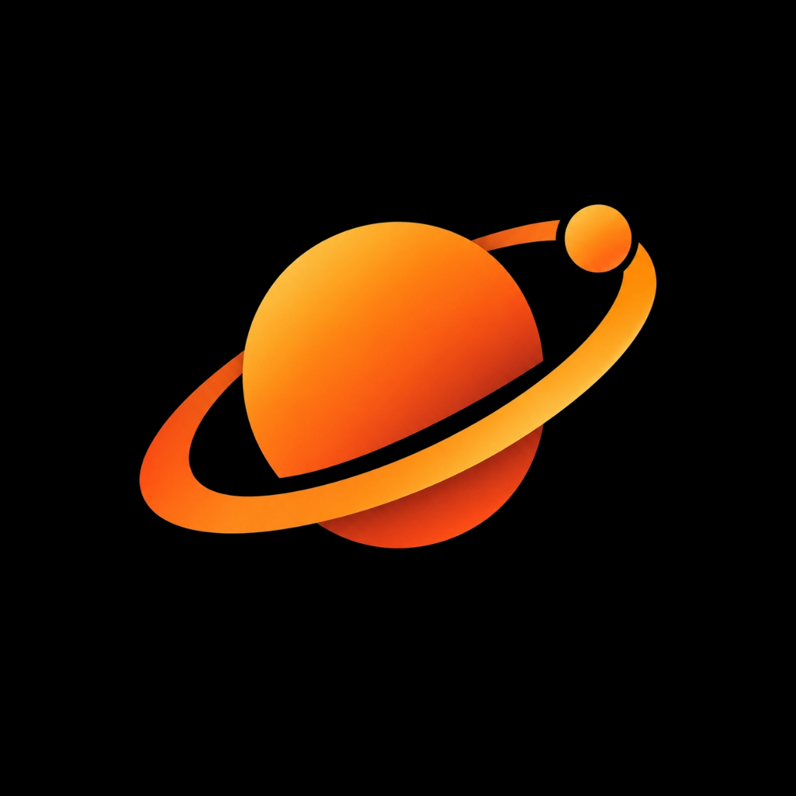
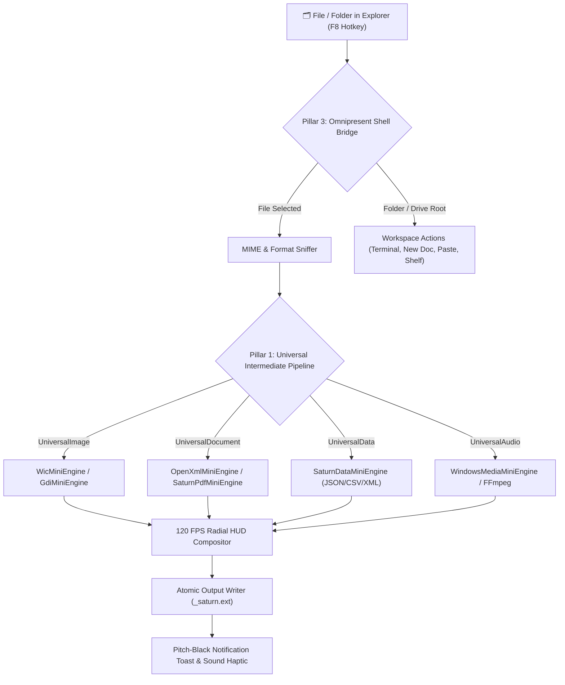

<div align="center">

  

  # **S A T U R N**

  ### *The Next-Generation, Zero-Drag Radial Context Workspace for Windows*

  [](https://github.com/DaivikOPX/Orbit)
  [](https://github.com/DaivikOPX/Orbit/releases)
  [](https://github.com/DaivikOPX/Orbit)
  [](LICENSE)
  [](https://github.com/DaivikOPX/Orbit)

  <br />

  <p align="center">
    <b>Transform • Convert • Compress • Inspect</b><br />
    Select any file in Windows Explorer, press <b>F8</b> or flick your mouse, and execute instant high-fidelity transformations in milliseconds.
  </p>

  <p align="center">
    <a href="#-key-features"><b>Key Features</b></a> •
    <a href="#-supported-conversions"><b>Supported Formats</b></a> •
    <a href="#-quick-start"><b>Quick Start</b></a> •
    <a href="#-architecture"><b>Architecture</b></a> •
    <a href="#-compilation"><b>Build From Source</b></a> •
    <a href="#-license"><b>License</b></a>
  </p>

</div>

---

## ✦ Overview

**Saturn** is a hyper-minimalist, hardware-accelerated radial HUD and universal file engine for Windows. Designed to eliminate the slow, cluttered nested menus of traditional file utilities, Saturn provides a unified, fluid workspace for high-speed file manipulation.

1. **Instant Selection**: Click or select any file in Windows Explorer or Desktop.
2. **Radial HUD Summon**: Press **F8** (or right-click to choose "Saturn Quick Tools"). A fluid, 120 FPS radial wheel unfolds with spring physics around your cursor.
3. **Atomic Execution**: Select your target operation. Saturn transforms the asset atomically, writes the result cleanly alongside your source file as `[name]_saturn.[ext]`, and alerts you with a sleek, pitch-black notification card with 1-click actions.

---

## ⚡ Key Features

### 🪐 Minimalist Pitch-Black Notification System
Saturn features a completely re-engineered notification toast card:
- **Pure Pitch Black** (`#000000`) obsidian background with sleek dark borders.
- **Saturn Radiant Gold & Orange Accents** (`#FF7A00` / `#FF8C00`) matching planetary ring aesthetics.
- **Interactive Action Buttons**: 1-click "Open File" and "Show in Folder" buttons built right into the toast card.
- Smooth hardware-accelerated cubic-easing fade animations.

### 🎯 Context-Aware Intelligence
Saturn dynamically sniffs file headers, magic bytes, and MIME types to present only optimal, high-value transformations:
- **Images** → WebP, PNG, JPEG, ICO, TIFF, BMP, PDF, Grayscale, Rotate 90°, Lossless Compress
- **Videos** → MP4, WebM, MKV, AVI, MOV, Animated GIF, Audio Extractor (MP3/WAV), Mute Audio
- **Audio** → MP3, WAV, FLAC, AAC, M4A, OGG, OPUS
- **Documents** → Markdown, HTML, Plain Text, PDF (Native Print), DOCX (Clean OpenXML embedding)
- **Data & Tables** → JSON, CSV, XML, Markdown Table, HTML Grid

### 🚀 120 FPS Native Hardware Compositor
Built directly on Windows Presentation Foundation (WPF) with DirectWrite and DirectX acceleration.
- **Zero Electron**, **zero Chromium**, **zero Node.js**.
- Idles at **0.0% CPU** and only **~20 MB RAM**.
- Standalone portable binary of only **~100 KB**.

### 🛡️ Atomic Fault Tolerance & No-Overwrite Guarantee
- **Atomic Staging**: Conversions write to isolated memory buffers or temp files before atomic disk swap, completely preventing partial or corrupt files.
- **Smart Disambiguation**: Files are named cleanly (`_saturn.ext`, `_saturn_2.ext`), guaranteeing zero data loss or accidental overwrites.
- **Multi-Engine Fallbacks**: Cascades automatically from native encoders (.NET OpenXML, WIC, GDI+) to FFmpeg without interrupting the user workflow.

---

## 📊 Supported Conversions & Operations

| Category | Input Formats | Available Target Operations |
| :--- | :--- | :--- |
| **🖼️ Images** | `.png`, `.jpg`, `.jpeg`, `.webp`, `.bmp`, `.tiff`, `.ico`, `.gif` | **PNG**, **JPG** (High-Q), **WEBP**, **ICO** (Multi-frame 256→16px), **BMP**, **TIFF**, **PDF**, **Grayscale**, **Lossless Compress**, **Rotate 90°** |
| **🎬 Video** | `.mp4`, `.mkv`, `.webm`, `.avi`, `.mov`, `.wmv`, `.flv` | **MP4** (H.264), **WebM** (VP9), **MKV**, **AVI**, **MOV**, **Animated GIF**, **Extract MP3**, **Extract WAV**, **Mute Audio Track** |
| **🎵 Audio** | `.mp3`, `.wav`, `.flac`, `.aac`, `.m4a`, `.ogg`, `.opus`, `.wma` | **MP3** (320 kbps), **WAV** (16-bit PCM), **FLAC** (Lossless), **AAC**, **M4A**, **OGG** (Vorbis), **OPUS** |
| **📄 Documents** | `.md`, `.markdown`, `.txt`, `.log`, `.csv`, `.json`, `.pdf`, `.docx` | **HTML** (Styled Document), **Markdown**, **Plain Text**, **PDF** (High-Res Render), **DOCX** (DrawingML Image & Formatting) |
| **🗄️ Structured Data** | `.csv`, `.json`, `.xml` | **CSV ↔ JSON**, **JSON ↔ XML**, **Markdown Table**, **HTML Data Table** |

---

## 🏛️ The Three Pillars of Saturn's Architecture

Saturn is built upon three core architectural pillars designed to deliver the Windows equivalent of Apple's deepest native frameworks:

### Pillar 1: The Universal Pipeline (Universal Intermediate Models)
Every transformation flows through a decoupled, high-fidelity universal intermediate model (**Decoder $\rightarrow$ Universal Model $\rightarrow$ Encoder**):
- **UniversalImage**: Raw 32-bit ARGB uncompressed frames, pixel formats, and color profiles. Decoders load to `UniversalImage`; encoders write to PNG, JPG, WEBP, ICO, BMP, TIFF, GIF, or PDF.
- **UniversalDocument**: Structured Document AST (`DocumentAst`: title, headings, paragraphs, lists, tables with cells, embedded images, and metadata). Decodes from PDF, DOCX, HTML, Markdown, and TXT; encodes into any document format.
- **UniversalData**: Tabular schema model (`DataTableSchema`: column headers and typed row dictionaries). Translates seamlessly across JSON, CSV, TSV, XML, HTML Data Table, and Markdown Table.
- **UniversalAudio**: Raw 32-bit float audio buffer for lossless resampling, LUFS loudness normalization, and container repackaging.

### Pillar 2: Specialized Windows Native Mini-Engines
High-performance zero-dependency native mini-engines for each specific domain:
- **`WicMiniEngine`**: Direct hardware-accelerated Windows Imaging Component (WIC) encoder/decoder via `System.Windows.Media.Imaging`. Zero external DLLs, native Windows GPU acceleration.
- **`GdiMiniEngine`**: Specialized GDI+ pixel processor for multi-frame 256→16px ICO packaging, B&W luminance grayscale filtering, and lossless 90° clockwise orientation rotation.
- **`OpenXmlMiniEngine`**: Native OpenXML packaging engine (`System.IO.Packaging.Package`) generating compliant `.docx` archives with styled headings, borders, tables, and embedded DrawingML images (`word/media/`).
- **`SaturnPdfMiniEngine`**: RFC 1950 zlib FlateDecode stream decompressor, pure C# stream parser, text/image extractor, and vector PDF generator.
- **`SaturnDataMiniEngine`**: RFC 4180 streaming CSV/TSV parser, recursive-descent JSON parser/serializer (`SaturnJson`), and structured XML engine.
- **`WindowsMediaMiniEngine`**: Windows Media Foundation & PCM wave audio pipeline with 2-pass EBU R128 (-14 LUFS) audio loudness normalizer and FFmpeg fallback.
- **`SaturnToolboxMiniEngine`**: 8 instant tools: Mute, Web-Friendly Compress, LUFS Normalizer, EXIF/GPS Scrubber, Snapshot Video Frame, SHA-256 Cryptographic Checksum, Rotate, and Grayscale.

### Pillar 3: Omnipresent Windows Shell & Selection Bridge
A unified context bridge that works across all Windows versions, drives, and directory structures:
- **Strict Rising-Edge F8 Detection**: Tracks key-down transitions (`isF8Down && !wasF8Down`). Prevents the common 20ms auto-dismiss bug caused by human key-release latency.
- **Multi-Monitor Virtual Screen Geometry**: Calculates exact bounds using `VirtualScreenLeft`, `VirtualScreenTop`, `VirtualScreenWidth`, and `VirtualScreenHeight`, positioning the radial dial at cursor on any monitor or arbitrary DPI scaling factor (100%, 125%, 150%, 200%).
- **Multi-Layer Selection Detection**:
  - *Layer 1 (Shell COM)*: Traverses `IShellWindows` across Explorer tabs to capture selected items or active folder path.
  - *Layer 2 (Window Hierarchy)*: Inspects foreground `CabinetWClass` window titles and drive paths (`D:\`, `E:\`).
  - *Layer 3 (Non-Blocking Clipboard)*: Background-thread `CF_HDROP` query with zero UI Dispatcher freezing.
  - *Layer 4 (Workspace / Folder Mode)*: When no file is selected in an active directory, Saturn does not fail or display blank petals. Instead, it opens in **Workspace Mode** with instant actions: `TERMINAL` (PowerShell here), `EXPLORE` (New Explorer window), `NEW DOC` (Word document), `NEW TEXT` (Note), `PASTE HERE` (Clipboard paste), `COPY PATH`, and `PIN SHELF`.



---

## ⚡ Quick Start

### Option 1: Standalone Download (Instant)
1. Download **[`Saturn.exe`](Saturn.exe)** from the repository releases.
2. Place `Saturn.exe` anywhere (e.g., `D:\orbit\` or `C:\Program Files\Saturn\`).
3. Launch `Saturn.exe`. It docks in your Windows System Tray and registers the **F8** global hotkey.
4. Select any file and press **F8** to open the radial dial, or right-click any file to use "Saturn Quick Tools".

*(Optional)* To enable full video and audio conversions:
- Place `ffmpeg.exe` alongside `Saturn.exe` or install via winget:
  ```powershell
  winget install Gyan.FFmpeg
  ```

---

## 🛠️ Build From Source

Saturn requires **zero external toolchains or SDKs**. It compiles out-of-the-box using the standard Microsoft .NET Framework compiler (`csc.exe`) bundled with Windows:

### 1-Click PowerShell Build
```powershell
.\build.ps1
```

### 1-Click Batch Build
```cmd
build.bat
```

### Manual Compilation
```powershell
$csc = "C:\Windows\Microsoft.NET\Framework64\v4.0.30319\csc.exe"
$refs = "PresentationFramework.dll,PresentationCore.dll,WindowsBase.dll,System.Xaml.dll,System.Windows.Forms.dll,System.Drawing.dll,System.Core.dll,System.dll,System.Xml.dll,System.Xml.Linq.dll,System.IO.Compression.dll,System.IO.Compression.FileSystem.dll"

& $csc /target:winexe /optimize+ /win32icon:Saturn.ico /out:Saturn.exe /r:$refs SaturnApp.cs
```

---

## 📂 Repository Layout

```text
D:\orbit\
├── 📄 SaturnApp.cs           # Complete C# WPF source code (~3,250 lines)
├── 🚀 Saturn.exe             # Standalone compiled binary (~100 KB)
├── 🎨 Saturn.ico             # Multi-layer Windows icon (16px to 256px)
├── 🖼️ saturn_logo.svg        # Scalable vector brand asset
├── 🖼️ saturn_logo.png        # High-resolution raster brand logo (Pitch-Black BG)
├── 🖼️ saturn_logo_transparent.png # High-resolution brand logo (Alpha Channel)
├── ⚙️ build.bat             # One-click Windows CMD compilation script
├── ⚡ build.ps1             # Automated PowerShell build script
├── 🏃 run.bat               # Fast background launcher
├── 📜 LICENSE               # MIT Open Source License
├── 📖 README.md             # Documentation & Architecture
├── 📁 .github/workflows/    # GitHub Actions CI workflow (Automated Build & Release)
├── 📁 scripts/
│   ├── download_ffmpeg.bat  # Automated FFmpeg setup batch script
│   └── download_ffmpeg.ps1  # PowerShell FFmpeg downloader
└── 📁 test_suite/
    └── verify_conversions.ps1 # Comprehensive 44-test automated validation suite
```

---

## 🧪 Verification & Automated Testing

Saturn includes an exhaustive end-to-end verification suite in [`test_suite/verify_conversions.ps1`](test_suite/verify_conversions.ps1):

```powershell
powershell -ExecutionPolicy Bypass -File .\test_suite\verify_conversions.ps1
```

**Verification Results: 44 / 44 Passed (100% Success Rate)**
- ✅ **Images (8/8)**: PNG, JPG, WEBP, ICO, BMP, TIFF, GIF, PDF
- ✅ **Videos (8/8)**: MP4, GIF, MP3, WEBM, MKV, MOV, AVI, WAV
- ✅ **Audio (6/6)**: MP3, WAV, FLAC, M4A, OPUS, OGG
- ✅ **Data & Tables (10/10)**: CSV ↔ JSON, JSON ↔ XML, Markdown Table, HTML Table, TXT
- ✅ **Documents (4/4)**: MD → PDF, MD → DOCX, MD → HTML, MD → TXT
- ✅ **Built-in Tools (8/8)**: Lossless Compress, Metadata Stripper, Grayscale, Rotate 90°, SHA-256 Checksum, Mute Video, Video Snapshot, Audio Normalize

---

## 🤝 Contributing

Contributions to Saturn are welcome! Feel free to:
1. Fork the repository
2. Create your feature branch (`git checkout -b feature/NewCapability`)
3. Commit your changes (`git commit -m 'feat: Add AVIF image support'`)
4. Push to the branch (`git push origin feature/NewCapability`)
5. Open a Pull Request

---

## 📄 License

Distributed under the **MIT License**. See [`LICENSE`](LICENSE) for details.

<br />

<div align="center">
  <sub>Engineered with precision for Windows 10 & 11 • Built by <a href="https://github.com/DaivikOPX">DaivikOPX</a></sub>
</div>
